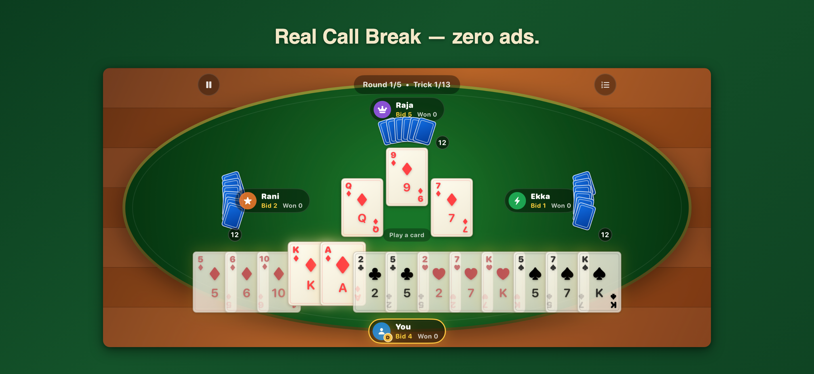

# CallBreak+

CallBreak+ is a native, landscape iOS implementation of the South Asian trick-taking game: one human player, three strategy-driven bots, five rounds, and optional regional house rules.

[Download on the App Store](https://apps.apple.com/us/app/call-break/id617853649) · [Product page](https://amitsapkota.me/callbreakplus/)

> Portfolio snapshot from August 2026. The source is published for technical review; the production repository and live development history remain private.



## What to inspect

- [`Engine/`](CallBreakPlus/Engine) — a Foundation-only state machine for bidding, legal moves, trick resolution, round scoring, and game completion.
- [`Bots/`](CallBreakPlus/Bots) — three strategies that depend on engine types without creating a reverse dependency.
- [`GameStateTests.swift`](CallBreakPlusTests/GameStateTests.swift) and [`BotTests.swift`](CallBreakPlusTests/BotTests.swift) — deterministic rules, phase transitions, and full bot-game coverage.
- [`StatsRepository.swift`](CallBreakPlus/Persistence/StatsRepository.swift) and [`StatsRepositoryTests.swift`](CallBreakPlusTests/StatsRepositoryTests.swift) — a SwiftData-free persistence contract with rollback and file-backed verification.

## Architecture

Views send intent to an observable main-actor `GameViewModel`; the view model sequences animation and bot pacing; the pure engine remains authoritative for rules and state transitions. Randomness enters through an injected generator, scores use integer tenths to avoid floating-point ties, and persistence sits behind a protocol so game logic never imports SwiftData.

Game rules and scoring details are documented in [SPEC.md](SPEC.md) and the dependency map in [ARCHITECTURE.md](ARCHITECTURE.md).

## Build and test

Requirements: Xcode 26 or newer and an iOS 17+ simulator.

```sh
xcodebuild -project CallBreakPlus.xcodeproj -scheme CallBreakPlus \
  -destination 'id=<CALLBREAKPLUS_SIMULATOR_UDID>' build

xcodebuild -project CallBreakPlus.xcodeproj -scheme CallBreakPlus \
  -destination 'id=<CALLBREAKPLUS_SIMULATOR_UDID>' test
```

The app has no external dependencies, backend, API keys, ads, or analytics SDK.

The exported snapshot was verified on an iPhone 17 Pro simulator: 88 tests passed.

## Privacy and license

Gameplay preferences and aggregate statistics remain on-device. Review [SECURITY.md](SECURITY.md) for disclosure guidance.

This is source-available portfolio code, not an open-source project. See [LICENSE](LICENSE).
