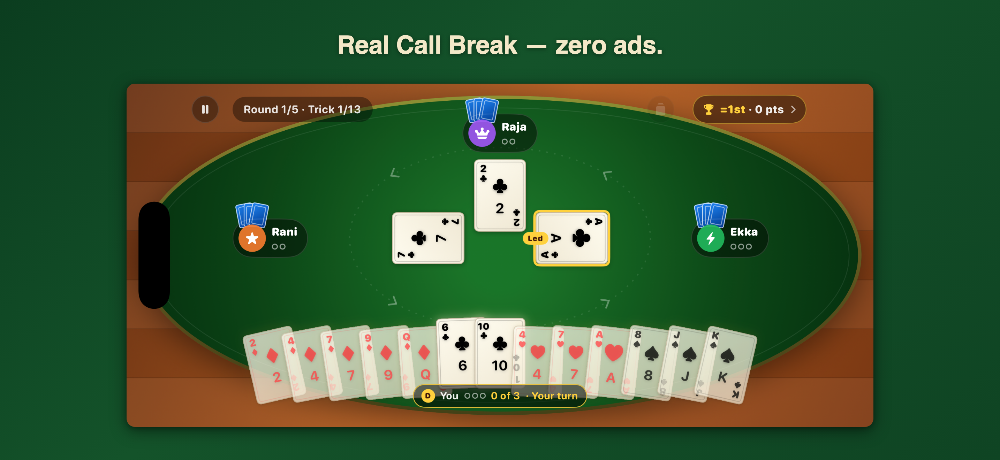

# CallBreak+ — deterministic game systems

CallBreak+ is a deterministic implementation of the South Asian trick-taking game: a headless rules state machine, three strategy-driven bots, five-round scoring, optional regional house rules, rollback-aware persistence with a versioned schema, and a StoreKit 2 entitlement layer for one optional upgrade. The production client ships on iOS; the engineering boundaries remain independent of presentation.

[Download on the App Store](https://apps.apple.com/us/app/call-break/id617853649) · [Product page](https://greatarc.app/callbreakplus/)

> Portfolio snapshot of the 3.0 release, October 2026. The source is published for technical review; the production repository and live development history remain private.



## What to inspect

- [`Engine/`](CallBreakPlus/Engine) — a Foundation-only state machine for bidding, legal moves, trick resolution, round scoring, and game completion.
- [`Bots/`](CallBreakPlus/Bots) — three strategies that depend on engine types without creating a reverse dependency.
- [`GameStateTests.swift`](CallBreakPlusTests/GameStateTests.swift) and [`BotTests.swift`](CallBreakPlusTests/BotTests.swift) — deterministic rules, phase transitions, and full bot-game coverage.
- [`StatsRepository.swift`](CallBreakPlus/Persistence/StatsRepository.swift) and [`StatsRepositoryTests.swift`](CallBreakPlusTests/StatsRepositoryTests.swift) — a SwiftData-free persistence contract with rollback and file-backed verification.
- [`StatsSchema.swift`](CallBreakPlus/Persistence/StatsSchema.swift) and [`StatsMigrationTests.swift`](CallBreakPlusTests/StatsMigrationTests.swift) — a versioned SwiftData schema, migrated from a real store written by the shipped pre-migration build.
- [`Store/`](CallBreakPlus/Store) and [`ProStoreTests.swift`](CallBreakPlusTests/ProStoreTests.swift) — the only StoreKit client, a pure gate from stored preferences to effective rules, and purchase, refund, Ask to Buy and restore tests against a `.storekit` configuration.

## Architecture

Views send intent to an observable main-actor `GameViewModel`; the view model sequences animation and bot pacing; the pure engine remains authoritative for rules and state transitions. Randomness enters through an injected generator, scores use integer tenths to avoid floating-point ties, and persistence sits behind a protocol so game logic never imports SwiftData.

Game rules and scoring details are documented in [SPEC.md](SPEC.md) and the dependency map in [ARCHITECTURE.md](ARCHITECTURE.md).

## Build and test

Requirements: Xcode 27 and an iOS 17+ simulator.

```sh
xcodebuild -project CallBreakPlus.xcodeproj -scheme CallBreakPlus \
  -destination 'id=<CALLBREAKPLUS_SIMULATOR_UDID>' build

xcodebuild -project CallBreakPlus.xcodeproj -scheme CallBreakPlus \
  -destination 'id=<CALLBREAKPLUS_SIMULATOR_UDID>' -parallel-testing-enabled NO test
```

Some view-model tests pace real time and are unreliable in parallel simulator clones, hence `-parallel-testing-enabled NO`.

The app has no external dependencies, backend, API keys, ads, or analytics SDK. The one in-app purchase uses StoreKit 2 on device, and its tests run against the bundled `Products.storekit` configuration.

The exported snapshot was verified with Xcode 27 on an iPhone SE (3rd generation) simulator running iOS 27: 216 tests in 25 suites passed.

## Privacy and license

Gameplay preferences and statistics remain on-device. Apple processes the optional purchase; the app reads its entitlement from StoreKit on device. Review [SECURITY.md](SECURITY.md) for disclosure guidance.

This is source-available portfolio code, not an open-source project. See [LICENSE](LICENSE).
